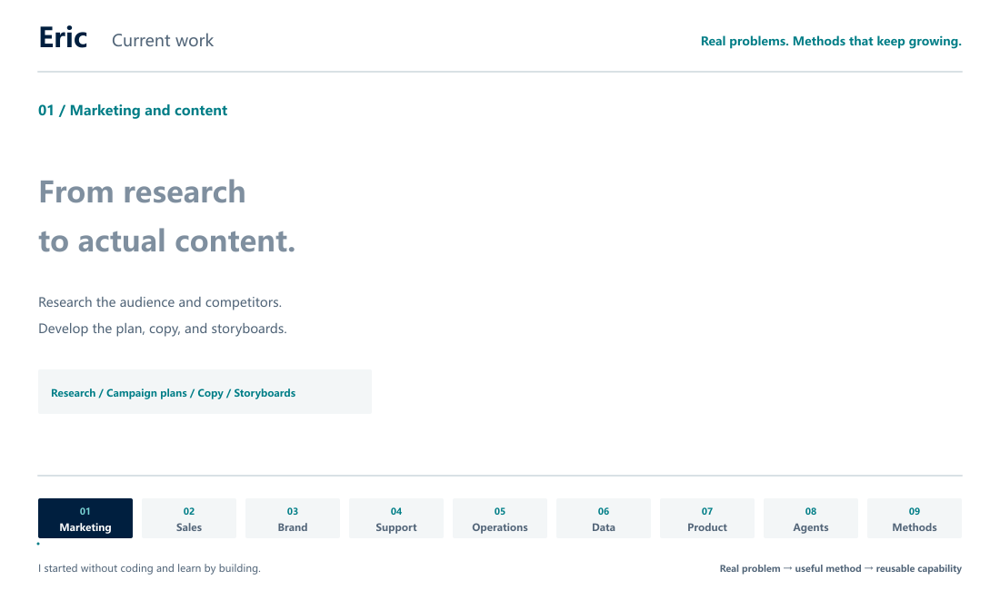

<a href="https://github.com/NewenergyEric">中文</a> · <strong>English</strong>

# Hi, I’m Eric 👋

I started without knowing how to code, learning to build products, create content, and improve workflows with AI agents. I work as an FDE (Forward Deployed Engineer), helping teams use AI in their everyday work. I’m also a gamer, curious about what gives a game its particular feel.

## The more I work with agents, the more people matter

I’ve spent a long time exploring agents, trying things out and learning from projects at several companies. The more work I did, the more I noticed how much depended on knowledge held by different people.

Someone understands the business. Someone knows the data and systems. Someone knows where things tend to go wrong. And someone has to take the result and do the next piece of work. Bringing in an agent means working through all of that together.

I began paying more attention to the connections: where a task starts, who can judge whether it’s been done well, how the result reaches the next person, and what we can use again. That’s what FDE work means to me: getting into those details with the people doing the work, and making them easier to handle.

[Enterprise AI Playbook](https://github.com/NewenergyEric/enterprise-ai-playbook) grew out of that process. I’m turning lessons from different projects into scenarios, workflows, and exercises, so the next person has something to build on.

I’ve come to see enterprise AI as a job of connecting a whole system: people, knowledge, tools, and the work between them. It needs more people taking part. I’m still learning, and I’d like to find others who want to keep exploring it with me.

## My art director friend

I have an art director friend who’s an artist through and through.

Talk to him about games, and he’ll talk about how a group of people can speak to each other through something they make. He cares about that elusive sense of how a game should feel.

For a while, we often met for meals or coffee. The same frustration kept coming up: he’d spent another whole day explaining what they were trying to make. To a new teammate. To an outsourcing partner. To AI that was increasingly willing to follow instructions, but had little judgment of its own.

I asked which part frustrated him most. He thought for a moment.

> It’s not that they do bad work. It’s that I have to explain it all from the beginning. We finish one version, and with the next, I start over.

He also worried about what happens when making a game becomes a matter of processes, parameters, and checklists. The art, the play, the fun can slip away.

I kept thinking about that conversation. As a gamer, I understood what he cared about. As an FDE, I wondered how other people could build on his judgment. He had good taste, but the reasoning behind it lived in his head, and in those few minutes when he explained it all over again.

So we kept talking. Through more conversations and interviews, we drew out the references, examples, and boundaries behind his choices: what could change, and what had to stay. We gave those judgments a form his teammates and their agents could return to. The creative decisions were still his. Now the feeling he cared about had a record other people could work from.

He uses it now.

That’s why I built [Art Director](https://github.com/NewenergyEric/art-director-skill) as a “visual memory”: **to help keep an artist’s sensibility from getting lost in the engineering.**

## Projects you can try

<table>
<tr>
<td width="50%" valign="top">

<strong>Bring AI into everyday work</strong>

I organized enterprise inputs, decisions, handoffs, and acceptance into a six-step workflow, 66 application scenarios, and a 12-week FDE Academy. Start with one task, then inspect your method through synthetic exercises and cases. The scenarios are not a count of validated customer deployments.

<a href="https://fde.aielsen.com/en/playbook/">Find a work scenario →</a> · <a href="https://github.com/NewenergyEric/enterprise-ai-playbook">Project</a>

<a href="https://fde.aielsen.com/academy/en/">Start FDE Academy</a> · <a href="https://fde.aielsen.com/agent-cases/en/">Explore Agent work cases</a>

Source-available: personal learning, corporate internal learning, and non-production evaluation are permitted. Production or commercial reuse requires written authorization; third-party rights remain separate. <a href="https://github.com/NewenergyEric/enterprise-ai-playbook/blob/main/LICENSING.md">Usage boundaries</a>

</td>
<td width="50%" valign="top">

<strong>A visual memory a creator can pass on</strong>

Those conversations with my friend led me to organize references, samples, and review notes into something a team and its agents could work from. The campaign example shows how the approach extends beyond game art.

<a href="https://github.com/NewenergyEric/art-director-skill/tree/main/examples/campaign-studio-draft">Explore the campaign example →</a> · <a href="https://newenergyeric.github.io/art-director-skill/docs/landing.html#film">Watch the film</a>
</td>
</tr>
</table>

<strong>A recent experiment: four Skills for making a game</strong>

Games are one place I’m trying this approach. The aim is to connect research, analysis, production planning, and art direction so a solo creator or a team can work out what to do next.

| The question | Explore |
|---|---|
| Which direction is worth trying? | [Market research](https://github.com/NewenergyEric/game-market-intelligence) |
| How does this game work, and what supports that reading? | [Reverse analysis](https://github.com/NewenergyEric/game-reverse-analyst) |
| What work can we start, and how will we check it? | [Production planning](https://github.com/NewenergyEric/game-production-manager) |
| How can different contributors follow the same art direction? | [Art direction](https://github.com/NewenergyEric/art-director-skill) |

Explore **[Game Dev Skills: four roles, one handoff](GAME-DEV-SKILLS.en.md)** for the entry points, inspectable cases and workflow. Solo creators switch roles; teams carry sources, versions and open decisions forward.

## Where I’m still experimenting

<picture>
  <source media="(prefers-reduced-motion: reduce)" srcset="media/work-still-en.png">
  
</picture>

<a href="media/work-still-en.png">View the still image</a>

<strong>Nine areas of work, and what I’m trying in each</strong>

| Area | The work I’m trying to make easier |
|---|---|
| **Marketing & content** | Carry audience research into a campaign, copy, visuals, and video storyboards. Keep what we learned useful through each revision. |
| **Sales & partnerships** | Understand a prospect or partner, prepare a relevant proposal, and keep the next conversation clear. |
| **Brand & positioning** | Explain who a product helps and why someone would choose it. Bring that idea into its words and visuals. |
| **Support & knowledge** | Find the right information, draft a useful reply, and keep corrections so the next answer improves. |
| **Operations & teamwork** | Make it clear what’s ready, what’s stuck, and who takes the next step. |
| **Data & decisions** | Check how the numbers were calculated, investigate changes, and work out what to try next. |
| **Products & interaction** | Turn a need into a usable tool, from browser helpers and local apps to voice and learning experiences. |
| **Agent collaboration** | Help AI find the right material and use tools to finish a task, with people making the decisions that need judgment. |
| **Methods & learning** | Turn useful experience and mistakes into guides, exercises, and Skills that others can build on. |

## Tell me about what you’re working on

I want to keep finding ways for people’s judgment and experience to stay useful in their work, and for the next person to have something to build on.

If you’re putting agents to work, or you have a way of doing things that you’re tired of explaining from scratch, I’d like to hear your story. We can start with one concrete problem and see what we can make together.

[Browse the projects →](https://github.com/NewenergyEric?tab=repositories) · [Explore the work guides →](https://fde.aielsen.com/en/)

Made by Eric and Agents. Still learning, still building.
