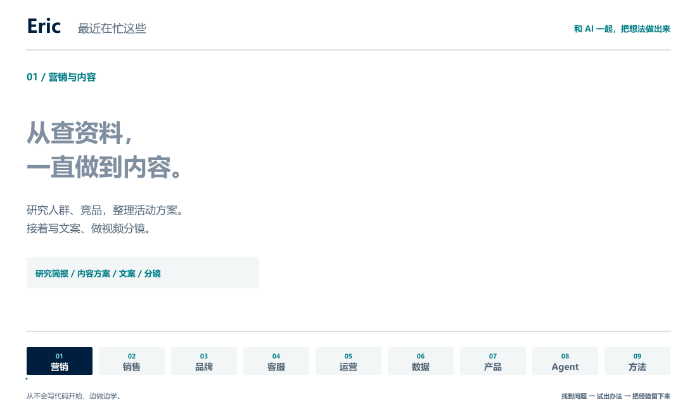

<strong>中文</strong> · <a href="https://github.com/NewenergyEric/NewenergyEric/blob/main/README.en.md">English</a>

# 你好，我是 Eric 👋

**从不会写代码开始，和 AI 一起，边学边把想法做出来。**

我和 AI Agent 一起做产品、做内容、改进工作流程。最关心的是：**工作里到底哪里卡住了，AI 能不能帮上忙？** 从把一个产品说清楚，到让客服查对资料、让团队少一点反复沟通，都是我正在尝试的事。

有用的办法，我会把它留下来，变成工具、流程和 Skill——也就是 AI 能照着做的工作方法。这样，人的经验能变成团队和 AI 可以接着用、继续改的能力。

<picture>
  <source media="(prefers-reduced-motion: reduce)" srcset="media/work-still-zh.png">
  
</picture>

<a href="media/work-still-zh.png">查看静态图</a>

## 最近在忙什么

很多项目，都是从一句“这件事能不能做得更好一点”开始的。我现在主要在这些地方尝试：

| 方向 | 我想把这些事做得更顺 |
|---|---|
| **营销与内容** | 从了解人群、研究竞品，到活动方案、文案、图片和视频分镜，让前面做过的研究在后面派上用场。 |
| **销售与合作** | 先了解客户和伙伴，再准备提案、沟通重点与跟进安排，让每一次联系都有具体的理由。 |
| **品牌与定位** | 把“给谁用、解决什么、为什么选你”说清楚，再一起做文案和视觉。 |
| **客服与知识** | 把散落的资料找齐，帮同事准备有依据的答复；改对过的问题，下次能记住。 |
| **运营与协作** | 这件事到哪了，还缺什么，该交给谁？让这些答案在流程里找得到。 |
| **数据与决策** | 先把数字的来龙去脉弄清楚，再看变化、找原因，决定下一步试什么。 |
| **产品与交互** | 把需求做成能用的工具，也在尝试浏览器助手、本地应用、语音和学习体验。 |
| **Agent 协作** | 让 AI 找得到资料、用得上工具、接得住任务，需要判断的地方有人把关。 |
| **方法与学习** | 把做成的方法和踩过的坑整理成指南、练习与 Skill，让下一次、下一个人能接着用。 |

## 几个可以直接看看的成果

<table>
<tr>
<td width="50%" valign="top">

<strong>把 AI 用进每天的工作</strong>

从营销、客服到运营，把工作怎么做、哪里需要判断，整理成指南、案例和练习。可以从眼前的一件事开始看。

<a href="https://fde.aielsen.com/zh/playbook/">找一个工作场景 →</a> · <a href="https://github.com/NewenergyEric/enterprise-ai-playbook">查看项目</a>
</td>
<td width="50%" valign="top">

<strong>让设计少一点反复解释</strong>

把参考图、样板和修改意见交给团队与 AI 接着用。做海报、商品、UI 或游戏美术，都能沿着同一套规范继续。

<a href="https://github.com/NewenergyEric/art-director-skill/tree/main/examples/campaign-studio-draft">看活动设计案例 →</a> · <a href="https://newenergyeric.github.io/art-director-skill/docs/landing.html#film">看短片</a>
</td>
</tr>
</table>

<strong>最近的一个实验：用四套 Skill 接起游戏开发（展开看项目）</strong>

游戏是其中一个实践场景。我在尝试把研究、分析、制作安排和美术协作接起来，让个人创作者和团队都知道下一步怎么做。

| 要解决的事 | 项目入口 |
|---|---|
| 先看看市场，再决定试哪个方向 | [市场研究](https://github.com/NewenergyEric/game-market-intelligence) |
| 看懂一个玩法，找到背后的规则与实现 | [拆解分析](https://github.com/NewenergyEric/game-reverse-analyst) |
| 把“想做什么”拆成能开工、能检查的任务 | [制作管理](https://github.com/NewenergyEric/game-production-manager) |
| 多人做出的素材，沿用同一套美术规范 | [美术指导](https://github.com/NewenergyEric/art-director-skill) |

我把四个入口、真实案例和交接关系整理成了 **[Game Dev Skills · 四岗位总览](GAME-DEV-SKILLS.md)**。个人按当前问题切换岗位；团队带着来源、版本与未定项交接。

## 我习惯怎么开始

先把一件真实的工作讲清楚：现在怎么做，哪里最费劲，怎样算做好。然后和 Agent 一起试出一个能用的办法，放回实际工作里检验，再继续改。最后，把有效的判断、做法和踩过的坑留下来，变成团队和 AI 能继续使用的方法。

**把眼前的问题解决好，也给下一次留下一点积累。**

我还在继续学。如果你也有一件总卡住的工作、一个想试的点子，或者一套值得传下去的经验，欢迎交流。从你眼前的那件事聊起就好。

[看看我在做的项目 →](https://github.com/NewenergyEric?tab=repositories) · [找一个工作场景 →](https://fde.aielsen.com/zh/playbook/)

English · a short introduction

I started without knowing how to code. Now I build products, create content, and improve workflows with AI agents. I look for real problems, try practical ways to solve them, and turn what works into tools and methods that people and agents can keep improving.

My work spans marketing, sales, brand, support, operations, data, products, agent collaboration, and learning.

[Read the full English profile →](README.en.md)

由 Eric 和 Agents 一起做出来，也一起继续学。
